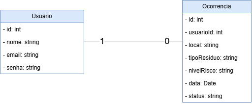

# Gestão de Resíduos Sólidos

## Descrição

Projeto desenvolvido para a Prefeitura de Amparo, com o objetivo de realizar o gerenciamento de resíduos sólidos e o registro de ocorrências de descarte irregular.

O sistema permite cadastrar, consultar, alterar e excluir usuários e ocorrências, realizar login e consultar a quantidade total de ocorrências tratadas.

## Diagrama de Classes



## Tecnologias utilizadas

- Node.js
- Express
- MariaDB / MySQL
- JavaScript
- Thunder Client
- Draw.io

## Banco de Dados

Nome do banco: `gestao_residuos`

Tabelas:

- `usuario`
- `ocorrencia`

Script SQL: `db/script.sql`

## Funcionalidades

- RF001: CRUD de usuários.
- RF002: Login de usuários.
- RF003: CRUD de ocorrências.
- RF004: Contagem total de ocorrências tratadas.

## Como executar o projeto

1. Inicie o Apache e o MySQL pelo XAMPP.
2. Acesse o phpMyAdmin.
3. Importe o arquivo `db/script.sql`.
4. Abra o terminal na pasta do projeto.
5. Execute:

```bash
npm install
```

6. Inicie o servidor:

```bash
npm run dev
```

7. Acesse `http://localhost:3000`.

## Rotas da API

| Método | Rota | Funcionalidade |
|---|---|---|
| GET | /usuarios | Listar usuários |
| GET | /usuarios/:id | Buscar usuário |
| POST | /usuarios | Cadastrar usuário |
| PUT | /usuarios/:id | Alterar usuário |
| DELETE | /usuarios/:id | Excluir usuário |
| POST | /login | Realizar login |
| GET | /ocorrencias | Listar ocorrências |
| GET | /ocorrencias/:id | Buscar ocorrência |
| POST | /ocorrencias | Cadastrar ocorrência |
| PUT | /ocorrencias/:id | Alterar ocorrência |
| DELETE | /ocorrencias/:id | Excluir ocorrência |
| GET | /ocorrencias/resumo/tratados | Contar ocorrências tratadas |

## Testes

Os testes foram realizados utilizando o Thunder Client.

As imagens estão disponíveis na pasta `docs/testes`.
